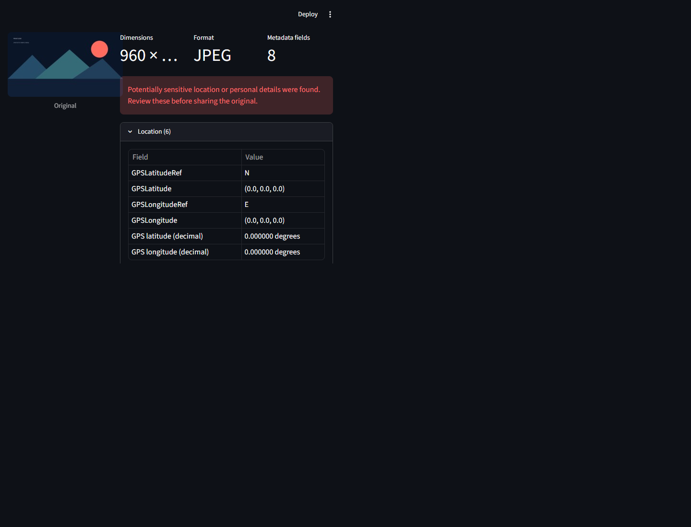
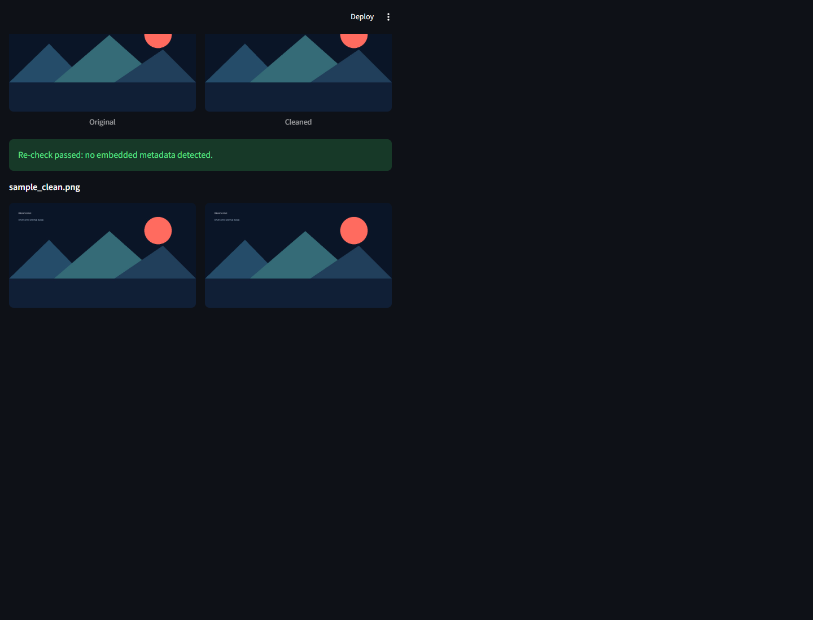

# PrivacyLens

PrivacyLens inspects image metadata, highlights privacy-sensitive fields, and creates a cleaned copy. It supports JPEG, PNG, and WebP, including batch cleaning into a ZIP archive.

## Demo





The demo inputs are generated synthetic images, not personal photos:

- [Image with sample metadata](samples/sample_with_metadata.jpg) includes a made-up capture time and GPS coordinates set to 0, 0.
- [Image without metadata](samples/sample_clean.png) is a generated image with no personal information.

## Run locally

```powershell
python -m venv .venv
.\.venv\Scripts\Activate.ps1
python -m pip install -r requirements.txt
python -m streamlit run app.py
```

Run these commands from the project root.

Upload one or more images (up to 10 files and 100 MB total) to review detected metadata. Findings are grouped into location, capture time, device, personal details, technical details, and other metadata. Choose **Clean and verify valid images** to see a before/after preview and confirm the cleaned output has no detected metadata. A single image downloads directly; multiple images download as a ZIP.

The app processes uploads in memory and does not write them to disk or forward them to third-party services. When run locally, uploads stay on your machine. If you deploy the app, uploads are sent to the server hosting it; disclose that to users and choose an appropriate deployment environment.

## Tests

```powershell
python -m pytest
```

## Notes

Cleaning re-encodes images. JPEG output can lose a small amount of quality, and color profiles are removed, which may affect color rendering. Keep the original if you need to preserve it.
